# 📱 Pocketdex

<p align="center">
  
  
  
  
</p>

<div align="center">
  <h3>Sua Enciclopédia Pokémon, Assistente Competitivo e Jogo de Batalha</h3>
  <p>App Android e site com a mesma conta: o que você faz em um aparece no outro.</p>
  <p>🌐 <a href="https://octaviokonzen.github.io/Pocketdex/"><b>Abrir o site</b></a> · 📥 <a href="https://github.com/OctavioKonzen/Pocketdex/releases/latest"><b>Baixar o APK</b></a></p>
</div>

---

## 📑 Sumário

- [Telas principais](#-telas-principais)
  - [Pokédex](#pokédex) · [Início (app)](#início-app) · [Pokémon](#pokémon) · [Times](#times) · [Montador de time](#montador-de-time) · [Jogo (Quem é esse Pokémon?)](#jogo-quem-é-esse-pokémon) · [Centro de Batalha](#centro-de-batalha) · [Calculadora de dano](#calculadora-de-dano) · [Treino](#treino) · [Enciclopédia](#enciclopédia) · [Amigos](#amigos) · [Conquistas](#conquistas) · [Configurações](#configurações)
- [Modos de batalha](#-modos-de-batalha)
  - [Como a batalha funciona](#como-a-batalha-funciona) · [Individual (1 contra 1)](#individual-1-contra-1) · [Escolhendo o golpe](#escolhendo-o-golpe) · [Dupla e tripla](#dupla-e-tripla) · [Golpes na dupla](#golpes-na-dupla) · [Contra o computador](#contra-o-computador) · [Online com amigos](#online-com-amigos) · [Draft](#draft) · [Jornada, Torre de Batalha e Battle Factory (Pokelike)](#jornada-torre-de-batalha-e-battle-factory-pokelike)
- [Apoie o projeto](#-apoie-o-projeto) · [Ferramentas](#️-ferramentas-usadas) · [Como usar](#-como-usar) · [Como rodar o código](#-como-rodar-o-código) · [Créditos](#-créditos)

> Cada tela aparece com a print do app (celular Android) à esquerda e a do site (computador) à direita, e a explicação logo embaixo. As telas são as mesmas nos dois: mesmo visual, mesmas regras e mesma conta.

---

## 🧭 Telas principais

### Pokédex

<table>
  <tr><th>📱 App</th><th>💻 Site</th></tr>
  <tr>
    <td align="center" valign="top">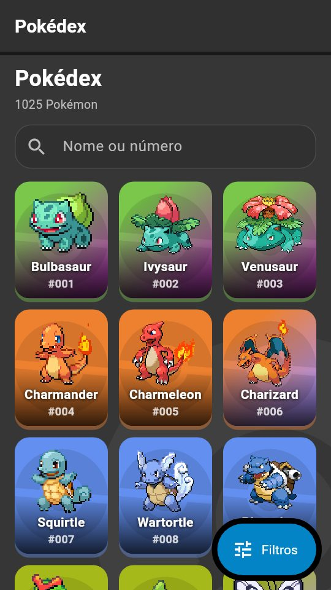</td>
    <td align="center" valign="top">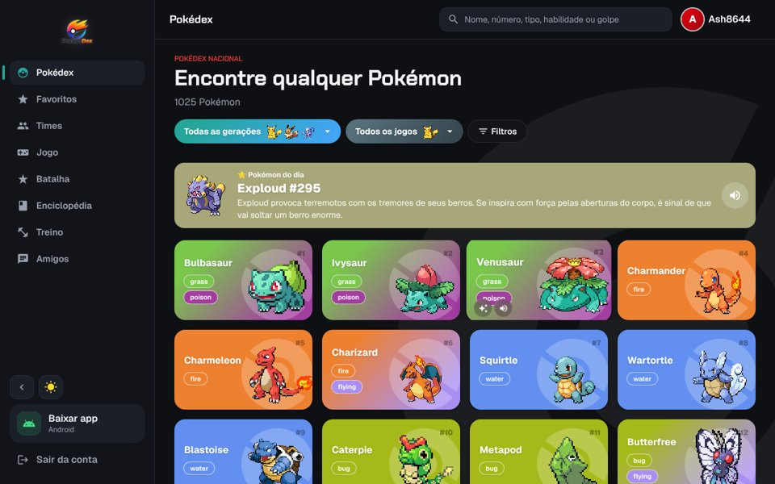</td>
  </tr>
</table>

A **Pokédex** lista os 1025 Pokémon com Megas, formas regionais e outras formas, sprites animados no estilo Black & White (normais e shiny) e filtros por geração, jogo, tipo, status e mais. No topo fica o **Pokémon do dia**, com o grito. No site, a Pokédex é a página inicial e os atalhos para as outras áreas ficam na barra de cima.

### Início (app)

<table>
  <tr><th>📱 App</th><th>💻 Site</th></tr>
  <tr>
    <td align="center" valign="top">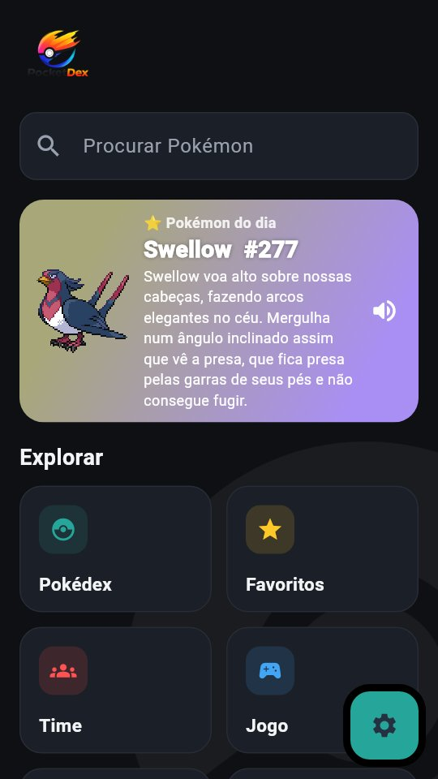</td>
    <td align="center" valign="top"><i>Só no app</i></td>
  </tr>
</table>

No app, o **Início** tem a busca, o Pokémon do dia e os atalhos para todas as áreas (no site, esses atalhos são a barra de cima).

### Pokémon

<table>
  <tr><th>📱 App</th><th>💻 Site</th></tr>
  <tr>
    <td align="center" valign="top">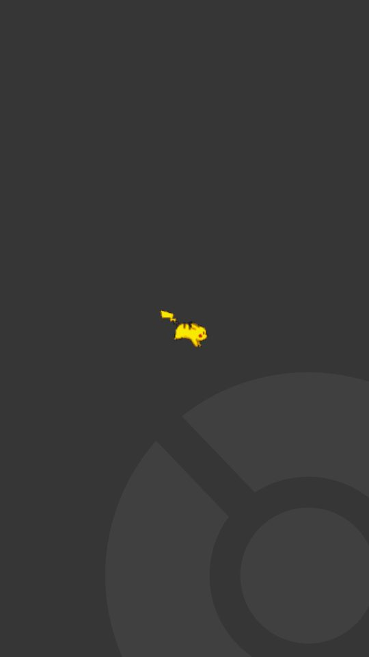</td>
    <td align="center" valign="top">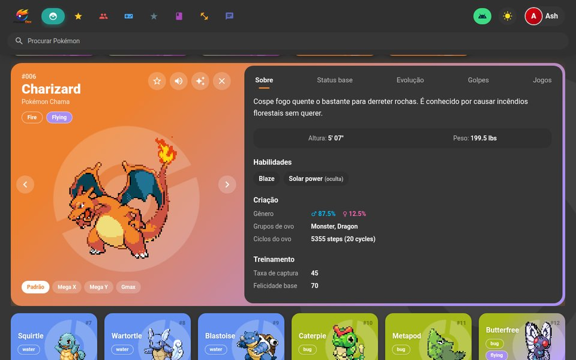</td>
  </tr>
</table>

A ficha de cada Pokémon: tipos, grito, forma shiny, outras formas (Mega, Gigantamax...), descrição, altura, peso, gênero e grupos de ovo, **status base**, **evolução**, **golpes** (por nível, TM, tutor e ovo), **habilidades** (inclusive a oculta) e a aba **Jogos**, que mostra em quais jogos ele aparece e onde encontrar.

### Times

<table>
  <tr><th>📱 App</th><th>💻 Site</th></tr>
  <tr>
    <td align="center" valign="top">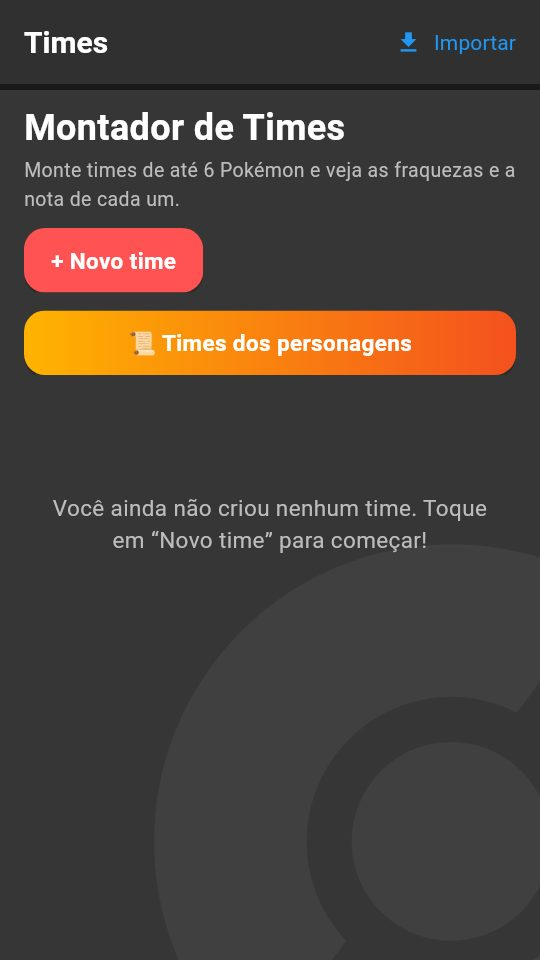</td>
    <td align="center" valign="top">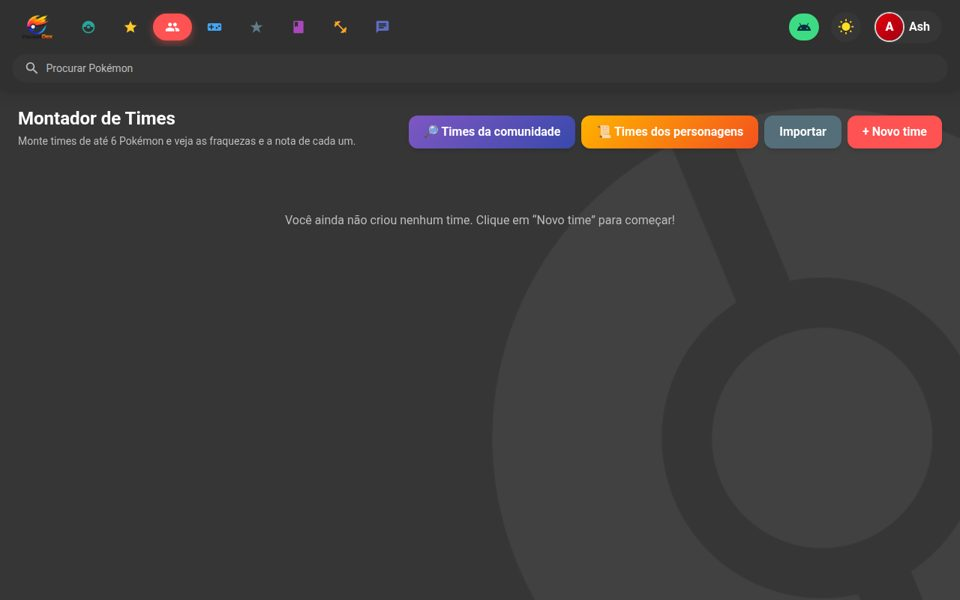</td>
  </tr>
</table>

A lista dos seus times, sincronizada com a conta. Daqui você cria um time novo, **importa** um time (link, código ou texto do Pokémon Showdown) e abre os **Times da comunidade** (times publicados por outros jogadores, com nota) e os **Times dos personagens** (líderes, Elite Four, campeões, rivais e vilões de cada jogo, da 1ª à 9ª geração).

### Montador de time

<table>
  <tr><th>📱 App</th><th>💻 Site</th></tr>
  <tr>
    <td align="center" valign="top">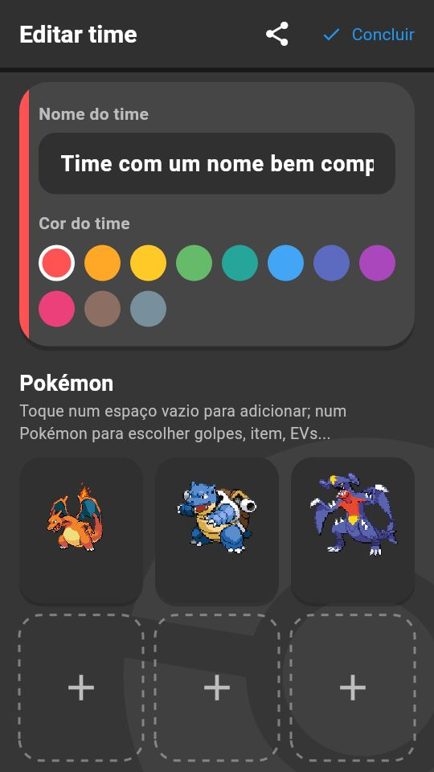</td>
    <td align="center" valign="top">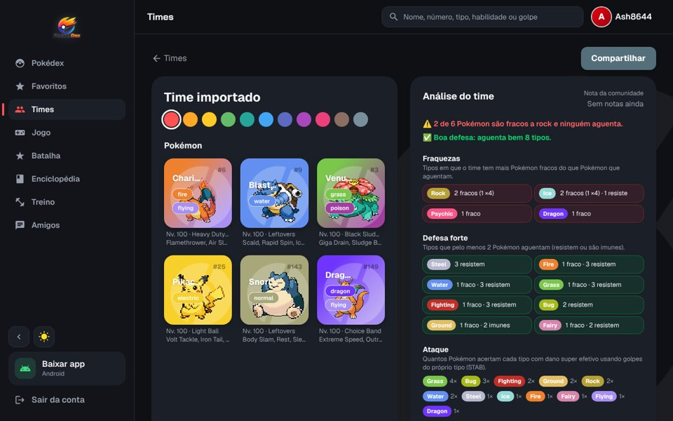</td>
  </tr>
</table>

Monte times de até 6 Pokémon com golpes, item, habilidade, Nature, EVs, IVs, Tera Type e a mecânica de cada um (Mega, Z-Move, Dynamax/Gigantamax ou Tera). A **análise do time** mostra fraquezas, defesa forte, cobertura de ataque e a nota da comunidade, e sugere quem completa a equipe. Dá para compartilhar por link, código ou texto do Showdown.

### Jogo (Quem é esse Pokémon?)

<table>
  <tr><th>📱 App</th><th>💻 Site</th></tr>
  <tr>
    <td align="center" valign="top">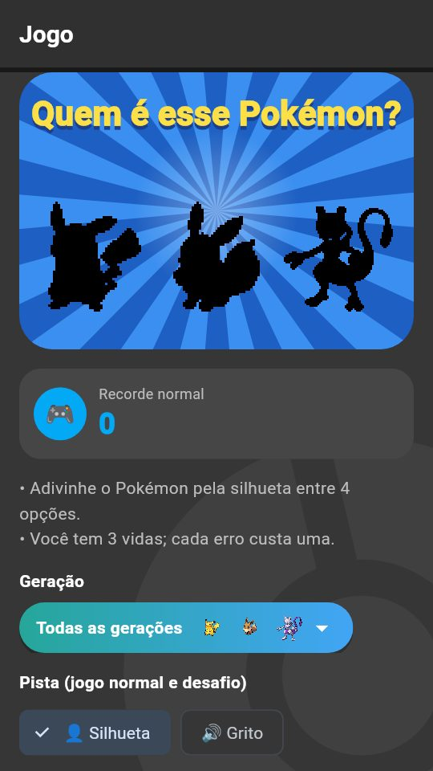</td>
    <td align="center" valign="top">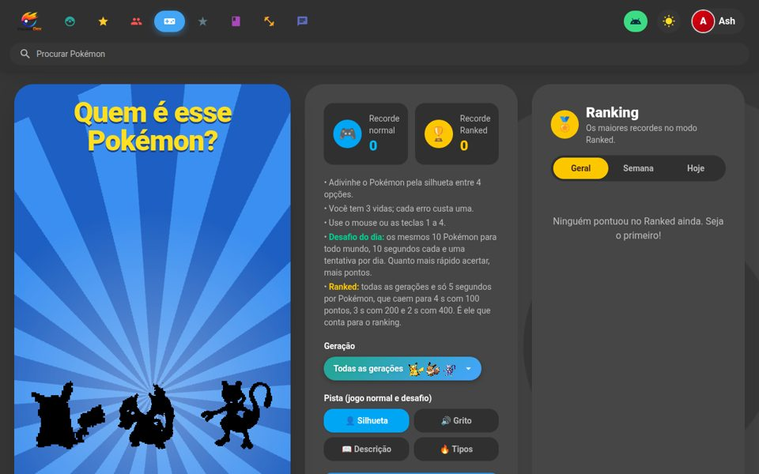</td>
  </tr>
</table>

Adivinhe o Pokémon entre 4 opções, pela **silhueta**, pelo **grito**, pela **descrição** ou pelos **tipos**. Tem o modo normal (3 vidas), o **Ranked** (5 segundos por Pokémon, vale ranking), o **Desafio do dia** (os mesmos 10 Pokémon para todo mundo) e desafios entre amigos, com rankings geral, da semana e do dia.

### Centro de Batalha

<table>
  <tr><th>📱 App</th><th>💻 Site</th></tr>
  <tr>
    <td align="center" valign="top">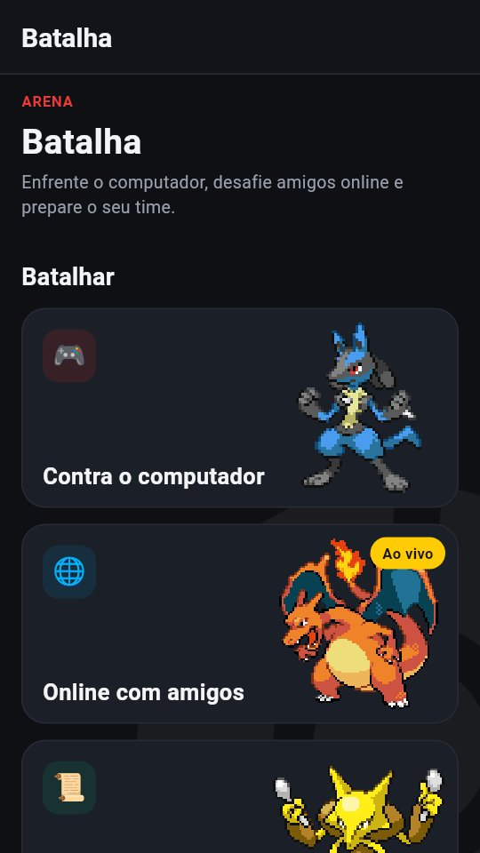</td>
    <td align="center" valign="top">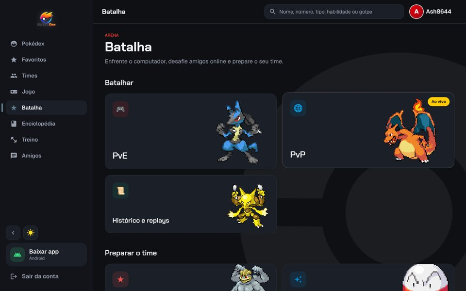</td>
  </tr>
</table>

O ponto de partida das batalhas (veja os [modos de batalha](#-modos-de-batalha)) e as ferramentas para preparar o time: **Calculadora de dano**, **Quem vence?** (quem ganha um contra um), **Faixas de velocidade**, **Comparar Pokémon**, **Tabela de tipos** e **Tera Raids**.

### Calculadora de dano

<table>
  <tr><th>📱 App</th><th>💻 Site</th></tr>
  <tr>
    <td align="center" valign="top">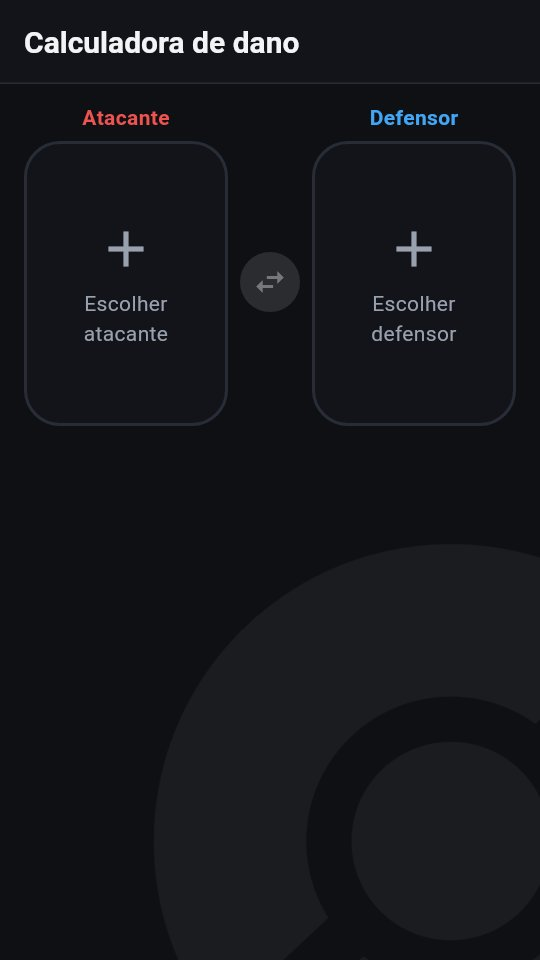</td>
    <td align="center" valign="top">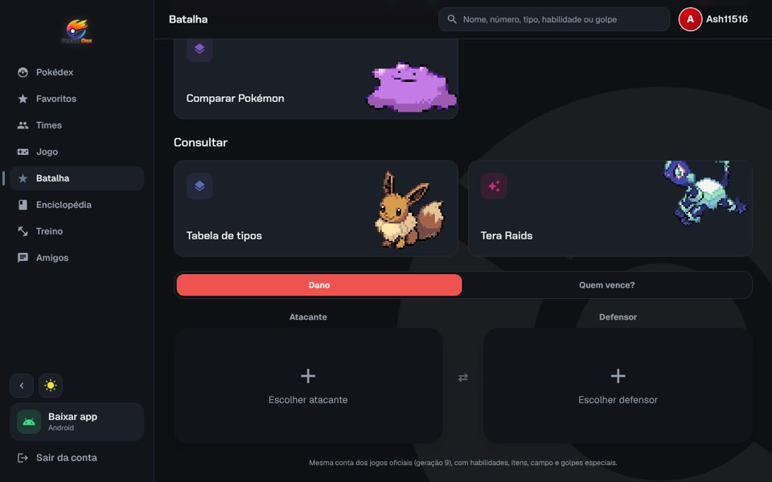</td>
  </tr>
</table>

Escolha o atacante e o defensor (com item, habilidade, Nature, EVs, IVs, Tera e boosts) e o campo (clima, terreno, telas). A calculadora mostra quanto cada golpe tira, em % e em HP, e quantos golpes precisa para derrubar. As contas são as mesmas do Pokémon Showdown, no app e no site.

### Treino

<table>
  <tr><th>📱 App</th><th>💻 Site</th></tr>
  <tr>
    <td align="center" valign="top">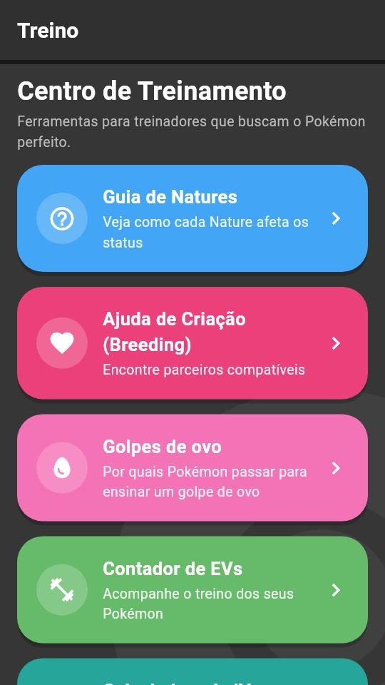</td>
    <td align="center" valign="top">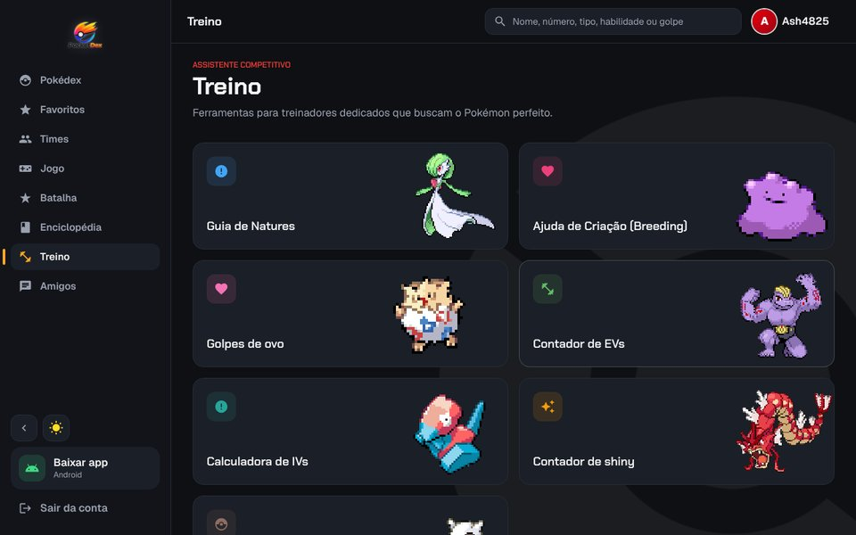</td>
  </tr>
</table>

Ferramentas de criação: **Guia de Natures**, **Breeding** (parceiros compatíveis), **Golpes de ovo** (quem passa o golpe), **Contador de EVs**, **Calculadora de IVs**, **Contador de shiny** e o acompanhamento de **Nuzlocke**.

### Enciclopédia

<table>
  <tr><th>📱 App</th><th>💻 Site</th></tr>
  <tr>
    <td align="center" valign="top">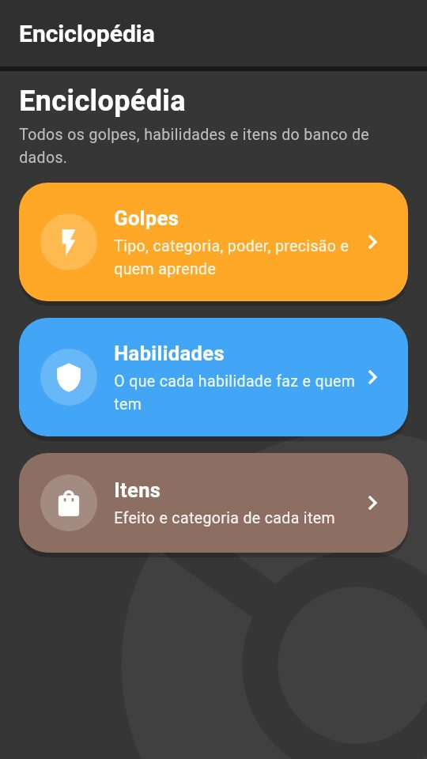</td>
    <td align="center" valign="top">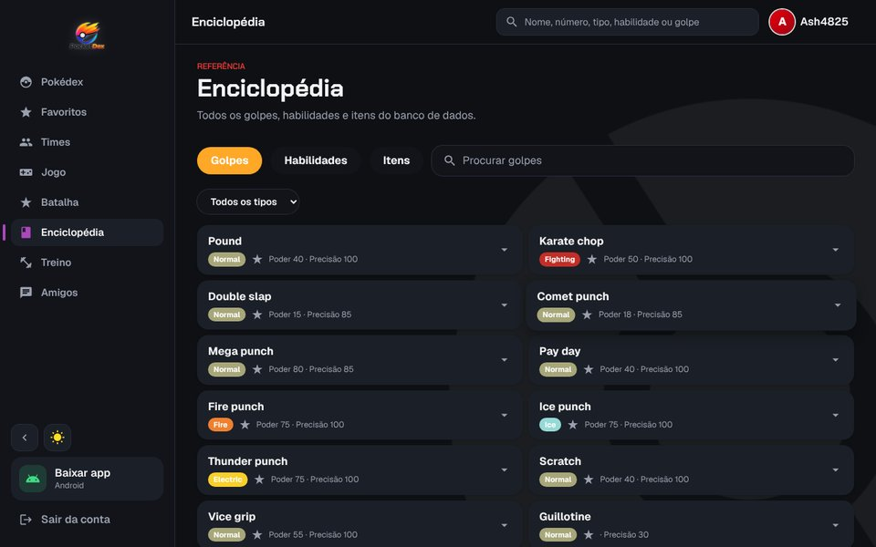</td>
  </tr>
</table>

Todos os **golpes** (tipo, categoria, poder, precisão e quem aprende), **habilidades** (o que fazem e quem tem) e **itens** (efeito e categoria), com busca e filtros.

### Amigos

<table>
  <tr><th>📱 App</th><th>💻 Site</th></tr>
  <tr>
    <td align="center" valign="top"><i>Só no site</i></td>
    <td align="center" valign="top">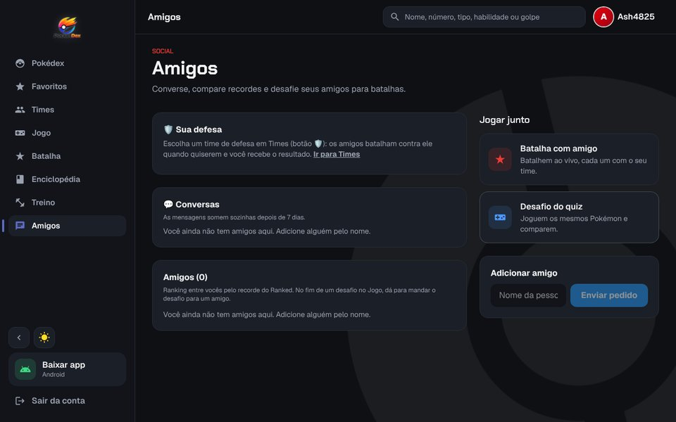</td>
  </tr>
</table>

Adicione amigos pelo nome, converse no chat (as mensagens somem em 7 dias), mande cartões de time e de Pokémon, desafie para o quiz ou para uma batalha online e compare os recordes do Ranked. No app, a tela é a mesma, com a mesma conta.

### Conquistas

<table>
  <tr><th>📱 App</th><th>💻 Site</th></tr>
  <tr>
    <td align="center" valign="top">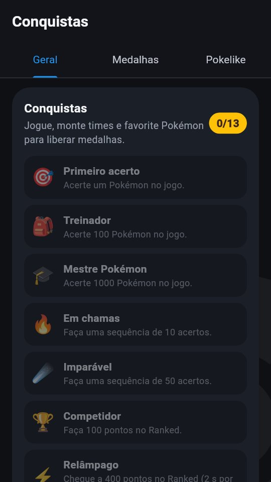</td>
    <td align="center" valign="top">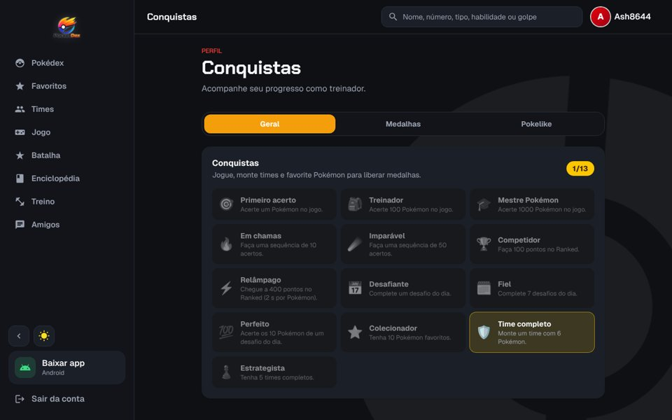</td>
  </tr>
</table>

Medalhas por jogar, montar times, favoritar Pokémon e avançar nas batalhas (inclusive as da Battle Factory).

### Configurações

<table>
  <tr><th>📱 App</th><th>💻 Site</th></tr>
  <tr>
    <td align="center" valign="top">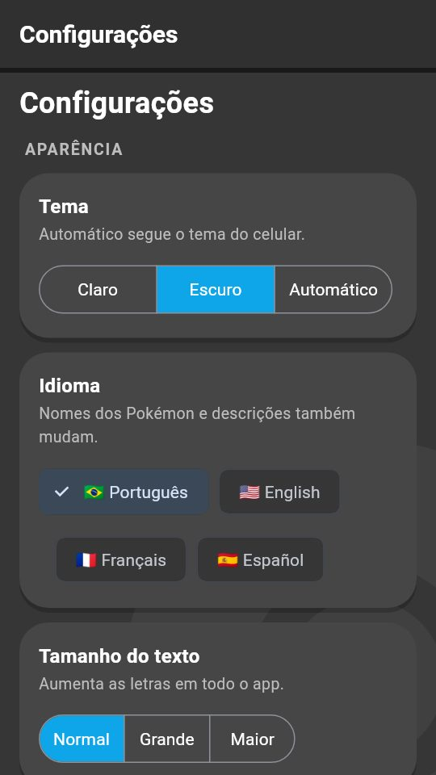</td>
    <td align="center" valign="top">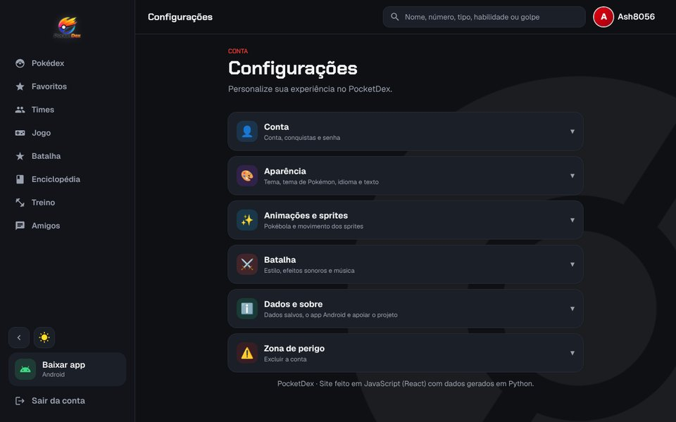</td>
  </tr>
</table>

A conta (Google ou e-mail), o tema claro/escuro, o idioma (português, inglês, francês e espanhol), o tamanho do texto, os sprites (animados, BW ou 3D) e o Pix para apoiar o projeto.

---

## ⚔️ Modos de batalha

### Como a batalha funciona

As batalhas são por turnos, no estilo **Black & White**, com o **mesmo motor** no app e no site (as regras do Pokémon Showdown): dano, precisão, prioridade, crítico, status, clima, terrenos, habilidades, itens equipados e os golpes de 2 turnos ou de recarga.

- **A tela é fixa, como num jogo oficial:** o campo tem sempre o mesmo tamanho, a fala aparece sempre na mesma caixa (o que não cabe vem em partes, com ▼) e os botões ficam sempre no mesmo lugar.
- **Menu:** **LUTAR** (os 4 golpes), **BOLSA** (Poções, Revive e, contra Pokémon selvagem, Poké Balls), **POKÉMON** (a tela do time com os 6, com TROCAR e DADOS) e **FUGIR** (conta como derrota).
- **Golpes:** cada botão mostra o PP, a chance de crítico, a **efetividade** e o **dano estimado** em % da vida do adversário.
- **Mecânicas:** Mega, Z-Move, Dynamax/Gigantamax e Tera, uma vez por batalha, pelo botão redondo no meio dos golpes.
- **Abertura:** a tela **VS** (contra treinador, chefe e online; contra Pokémon selvagem ele aparece direto), os treinadores lançando a Poké Ball e a música de cada lugar ou personagem.
- **Tudo com o mesmo tamanho:** Pokémon e treinadores na mesma escala, pela altura de cada um.

### Individual (1 contra 1)

<table>
  <tr><th>📱 App</th><th>💻 Site</th></tr>
  <tr>
    <td align="center" valign="top">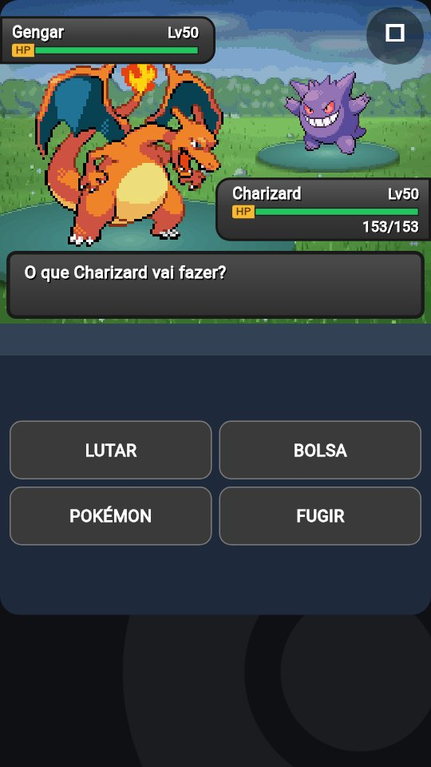</td>
    <td align="center" valign="top">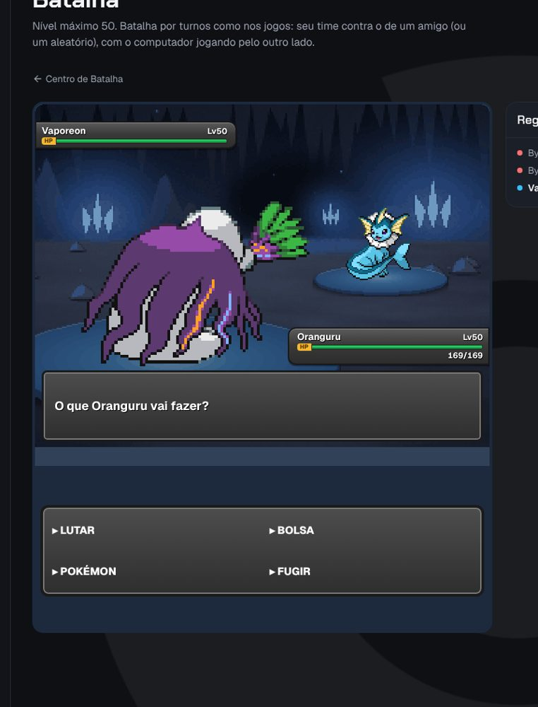</td>
  </tr>
</table>

Um Pokémon de cada lado, com o seu de costas e o adversário de frente, como nos jogos. Antes de começar, a **prévia dos times** mostra o time do adversário e você escolhe quem entra primeiro. O menu tem **LUTAR**, **BOLSA**, **POKÉMON** e **FUGIR**.

### Escolhendo o golpe

<table>
  <tr><th>📱 App</th><th>💻 Site</th></tr>
  <tr>
    <td align="center" valign="top">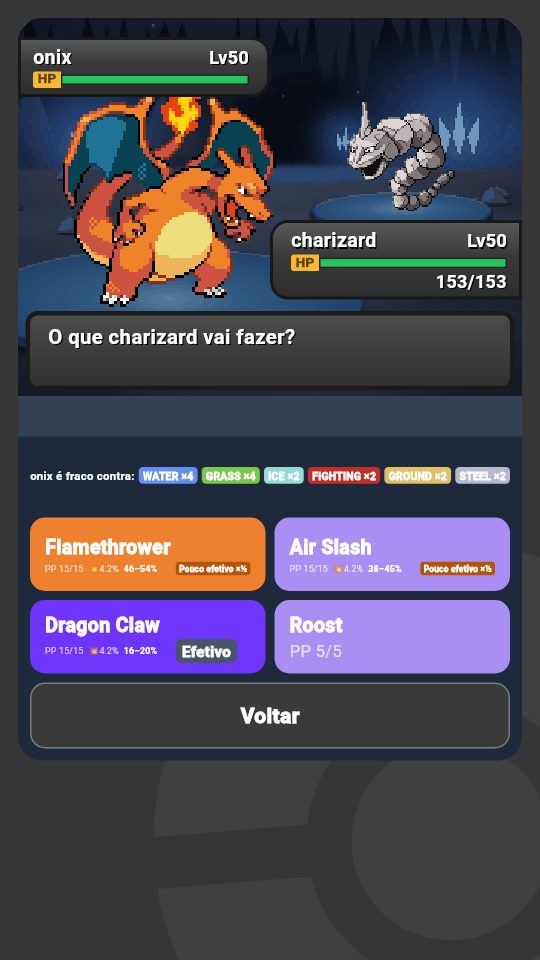</td>
    <td align="center" valign="top">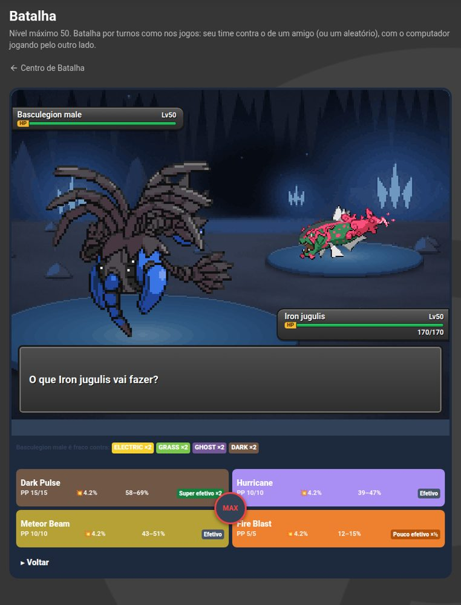</td>
  </tr>
</table>

Cada golpe mostra o tipo, o PP, a **efetividade** e o **dano estimado** em % da vida do adversário. O botão redondo no meio ativa a mecânica do Pokémon (Mega, Z-Move, Dynamax/Gigantamax ou Tera), uma vez por batalha.

### Dupla e tripla

<table>
  <tr><th>📱 App</th><th>💻 Site</th></tr>
  <tr>
    <td align="center" valign="top">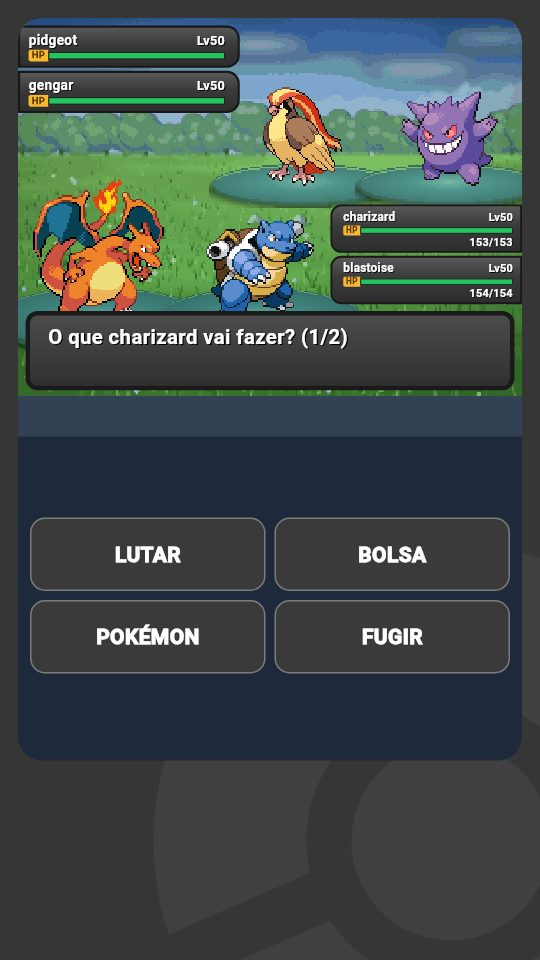</td>
    <td align="center" valign="top">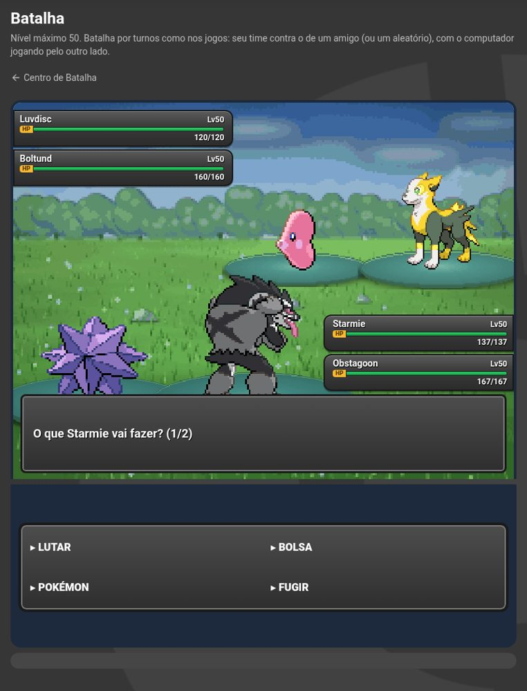</td>
  </tr>
</table>

Dois (ou três) Pokémon de cada lado, **com a mesma tela e os mesmos botões da individual**. Você escolhe o que cada um faz; depois o turno acontece na ordem da velocidade e da prioridade, como nos jogos, com a ordem do turno na caixa de texto. A BOLSA também funciona: quem usa o item gasta o turno dele.

### Golpes na dupla

<table>
  <tr><th>📱 App</th><th>💻 Site</th></tr>
  <tr>
    <td align="center" valign="top">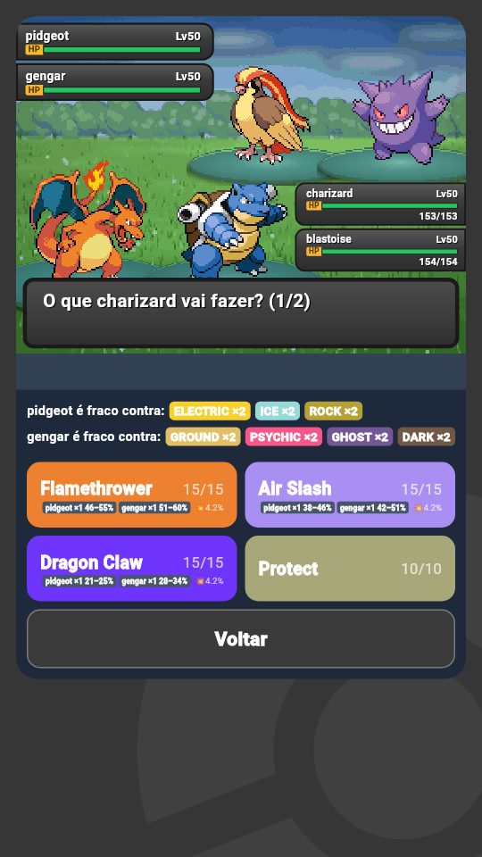</td>
    <td align="center" valign="top">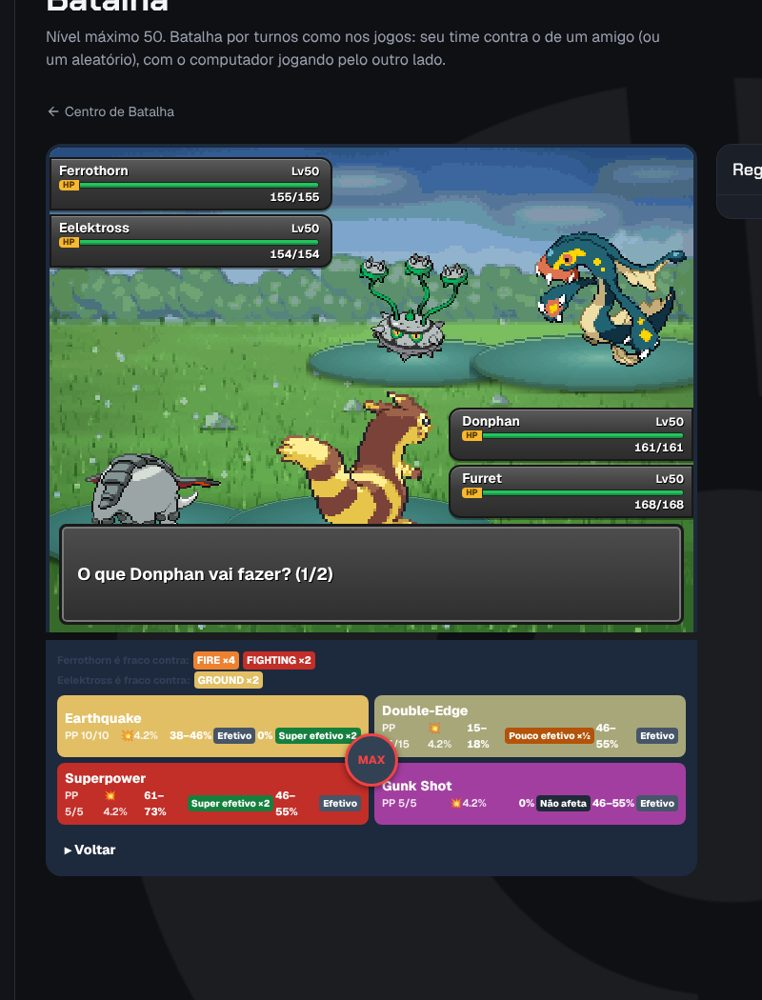</td>
  </tr>
</table>

Na dupla, cada golpe mostra o dano estimado em cada adversário, e depois você escolhe em quem usar (adversário ou aliado).

### Contra o computador

<table>
  <tr><th>📱 App</th><th>💻 Site</th></tr>
  <tr>
    <td align="center" valign="top">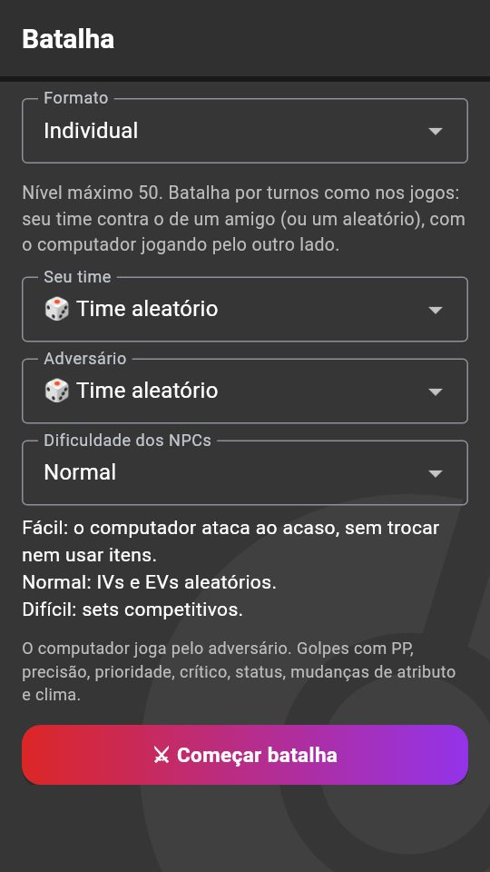</td>
    <td align="center" valign="top">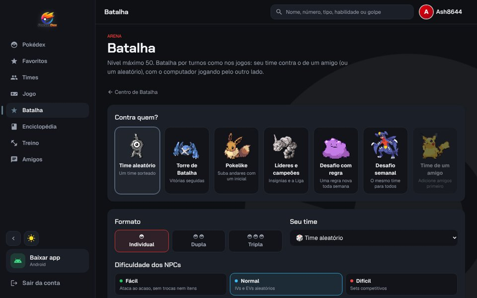</td>
  </tr>
</table>

Escolha o **formato** (individual, dupla ou tripla), o seu time (um dos seus ou aleatório), o adversário (time aleatório, o de um amigo, um líder de ginásio, a Torre de Batalha ou a Battle Factory) e a **dificuldade**: **Fácil** (o computador ataca ao acaso, sem trocar nem usar itens), **Normal** (IVs e EVs aleatórios) ou **Difícil** (sets competitivos).

### Online com amigos

Batalha ao vivo, cada um controlando o próprio time, com nível máximo 50 e tempo por turno. Dá para jogar individual, dupla ou tripla, inclusive amigos juntos contra a máquina: até 4 jogadores na dupla e 6 na tripla, cada equipe com 6 Pokémon e reserva compartilhada. Também tem adversário aleatório (fila), emotes, regras opcionais (como a Sleep Clause), **histórico** e **replays** com link para compartilhar.

### Draft

Você e um amigo escolhem Pokémon um de cada vez para montar os times e depois batalham com eles.

### Jornada, Torre de Batalha e Battle Factory (Pokelike)

- **Jornada (Desafio dos Líderes):** enfrente os líderes de ginásio de cada região com os times originais, ganhe as insígnias, desafie a Liga (Elite Four e Campeão) e entre no Hall da Fama.
- **Torre de Batalha:** batalhas seguidas para aumentar a sua sequência de vitórias.
- **Battle Factory (Pokelike):** um roguelike pela história de cada região. Você começa com um inicial grátis e segue pelo **mapa** de rotas e cidades, escolhendo o caminho em cada bifurcação: treinadores, Pokémon selvagens para **capturar**, eventos, vendedor ambulante, cura no caminho, cavernas e outros lugares até o **chefe** de cada cidade (líderes, rival, vilões, Elite Four e Campeão). A partir do andar 15 aparecem **duplas de treinadores** em batalha dupla. Nas cidades ficam o **Poké Mart**, o **Centro Pokémon** e a **Creche**. O XP vai para quem lutou (ou para todos com o Exp. Share) e os Pokémon evoluem. As moedas de cada corrida compram melhorias na **árvore de habilidades** e novos iniciais.

#### Battle Factory: começo da corrida

<table>
  <tr><th>📱 App</th><th>💻 Site</th></tr>
  <tr>
    <td align="center" valign="top">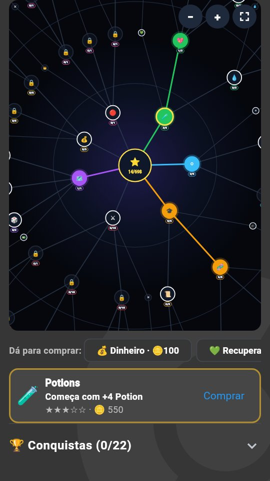</td>
    <td align="center" valign="top">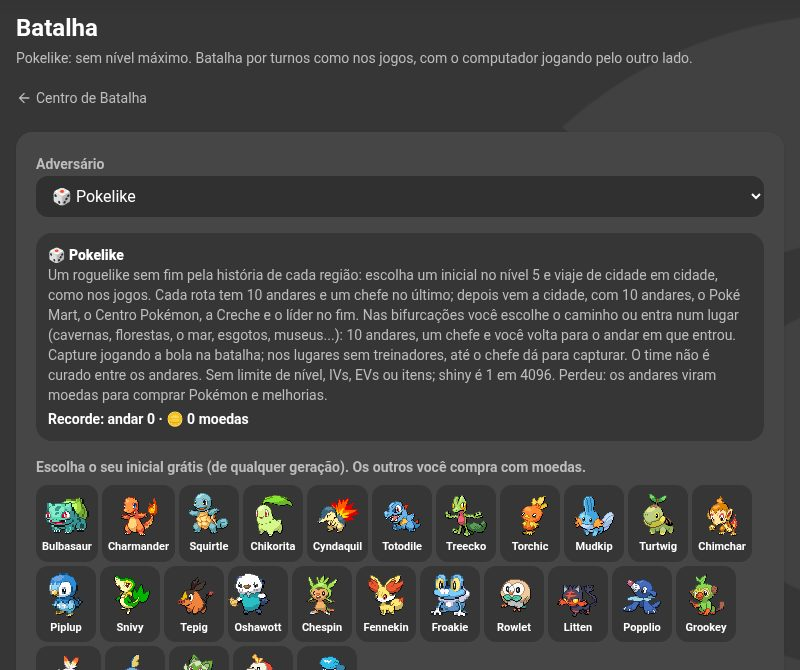</td>
  </tr>
</table>

Antes de cada corrida você escolhe o inicial e a região. As moedas de cada corrida compram melhorias na **árvore de habilidades** e novos iniciais.

#### Battle Factory: mapa

<table>
  <tr><th>📱 App</th><th>💻 Site</th></tr>
  <tr>
    <td align="center" valign="top">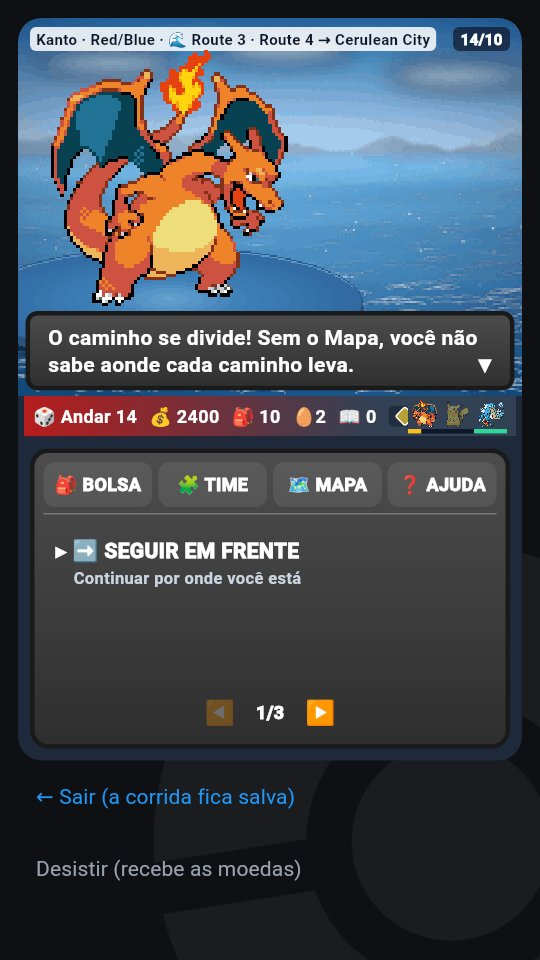</td>
    <td align="center" valign="top">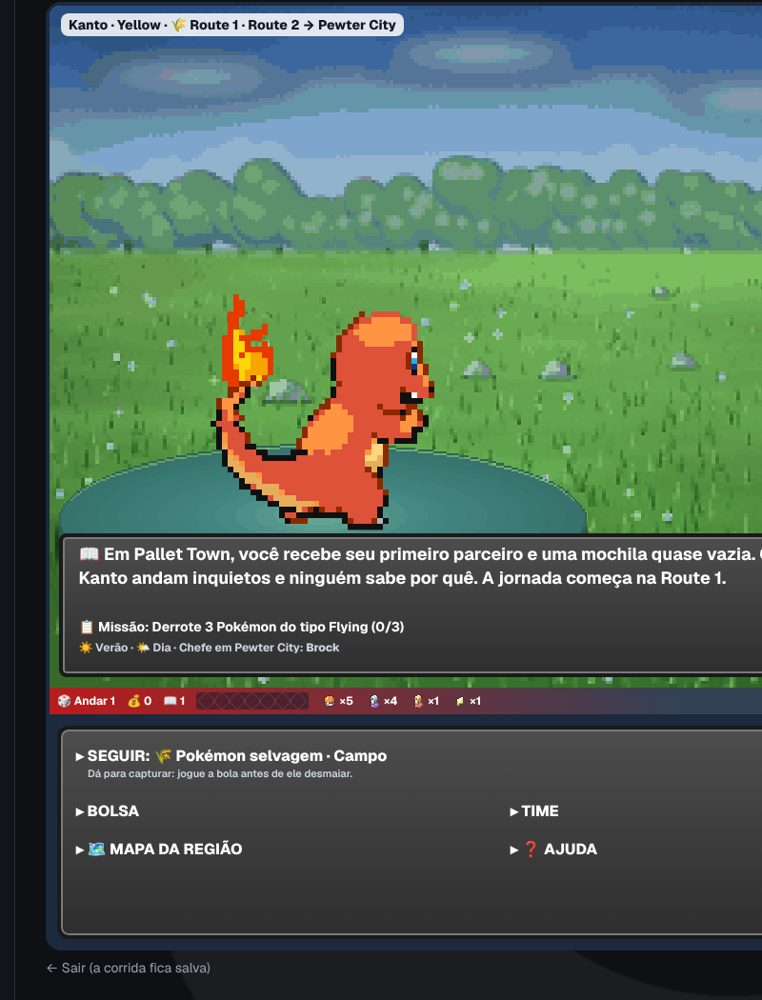</td>
  </tr>
</table>

O **mapa** de rotas e cidades da história de cada região. Em cada bifurcação você escolhe o caminho: treinadores, Pokémon selvagens para **capturar**, eventos, vendedor ambulante, cura no caminho, cavernas e outros lugares até o **chefe** de cada cidade (líderes, rival, vilões, Elite Four e Campeão). A partir do andar 15 aparecem **duplas de treinadores** em batalha dupla.

#### Battle Factory: batalha e captura

<table>
  <tr><th>📱 App</th><th>💻 Site</th></tr>
  <tr>
    <td align="center" valign="top">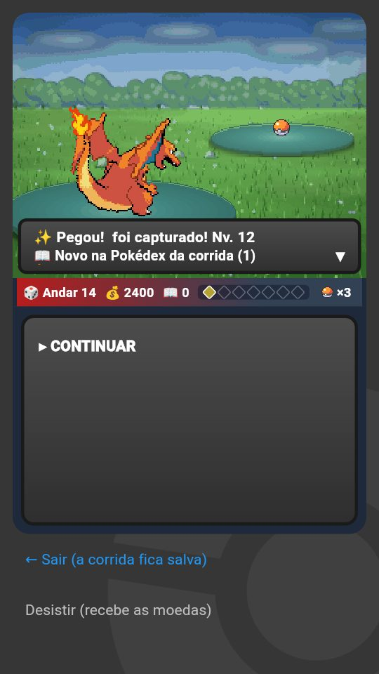</td>
    <td align="center" valign="top">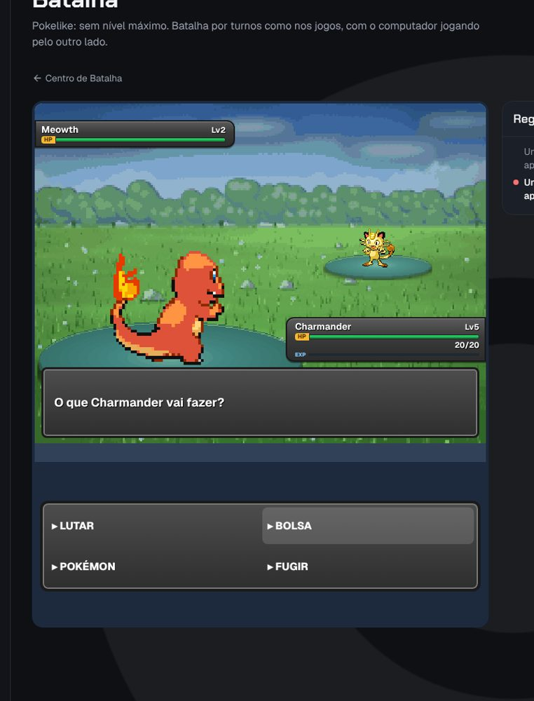</td>
  </tr>
</table>

As batalhas da corrida usam a mesma tela das outras. Contra Pokémon selvagem a BOLSA tem Poké Balls para capturar, e o XP vai para quem lutou (ou para todos com o Exp. Share). Os Pokémon sobem de nível e evoluem.

#### Battle Factory: cidade

<table>
  <tr><th>📱 App</th><th>💻 Site</th></tr>
  <tr>
    <td align="center" valign="top">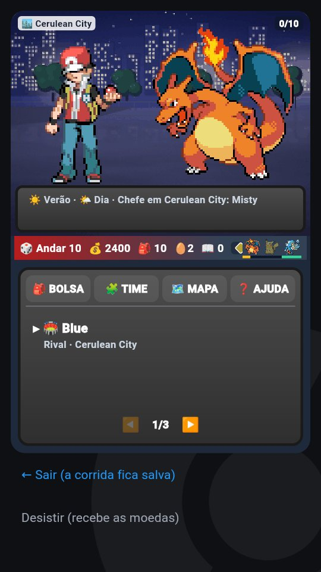</td>
    <td align="center" valign="top">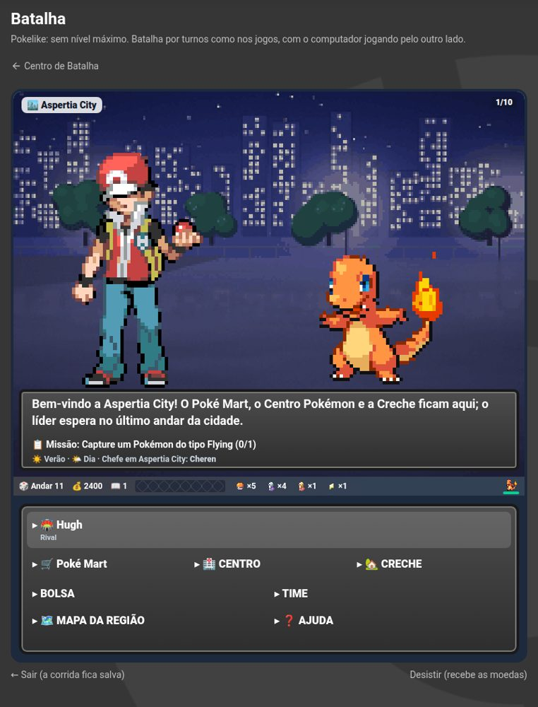</td>
  </tr>
</table>

Chegando numa cidade, você escolhe o que fazer: o **Poké Mart**, o **Centro Pokémon** (cura o time todo de graça), a **Creche**, o mapa da região e o **chefe** da cidade (líder, rival ou vilão), que espera no último andar.

#### Battle Factory: Poké Mart

<table>
  <tr><th>📱 App</th><th>💻 Site</th></tr>
  <tr>
    <td align="center" valign="top">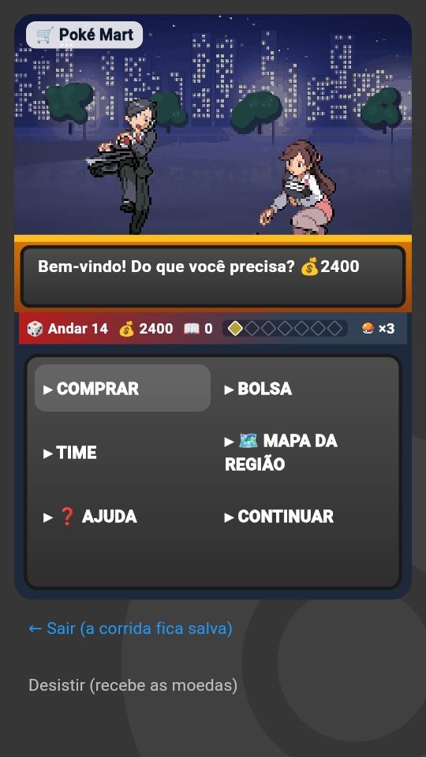</td>
    <td align="center" valign="top">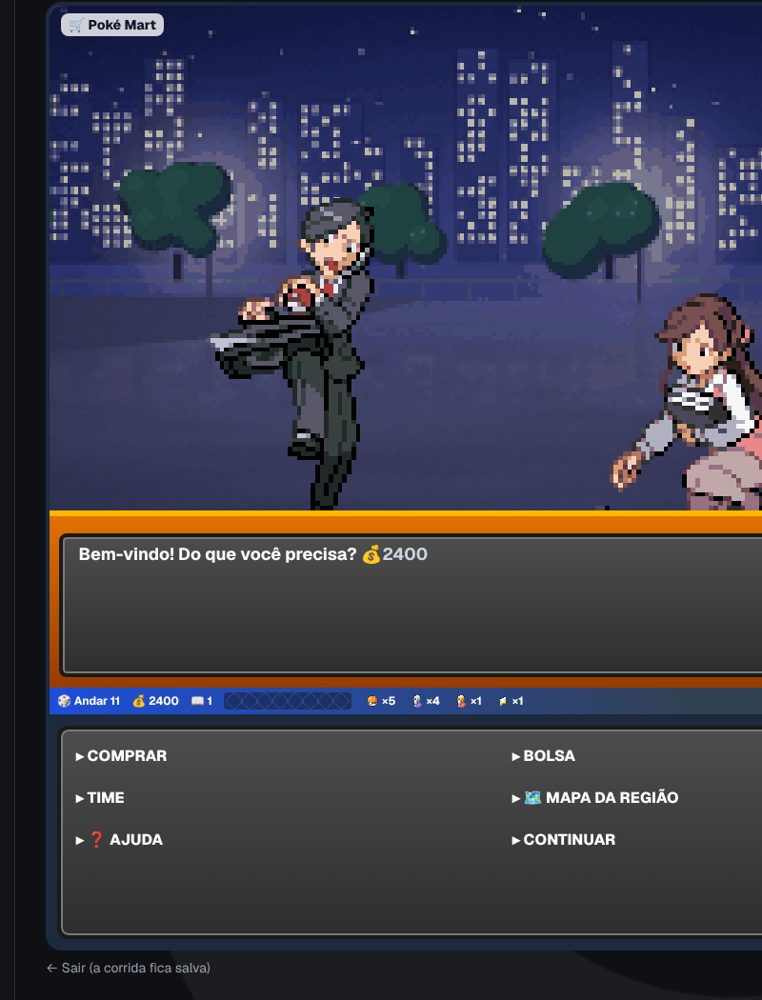</td>
  </tr>
</table>

A loja da cidade (e o vendedor ambulante na rota): Poké Balls, Poções, Revive, itens para equipar, pedras de evolução, TMs e mais, pagos com o dinheiro ganho nas batalhas.

#### Battle Factory: cura na rota

<table>
  <tr><th>📱 App</th><th>💻 Site</th></tr>
  <tr>
    <td align="center" valign="top">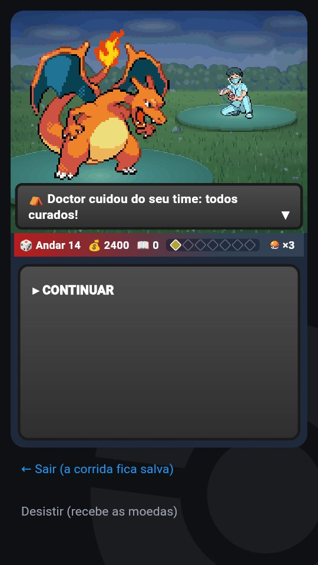</td>
    <td align="center" valign="top">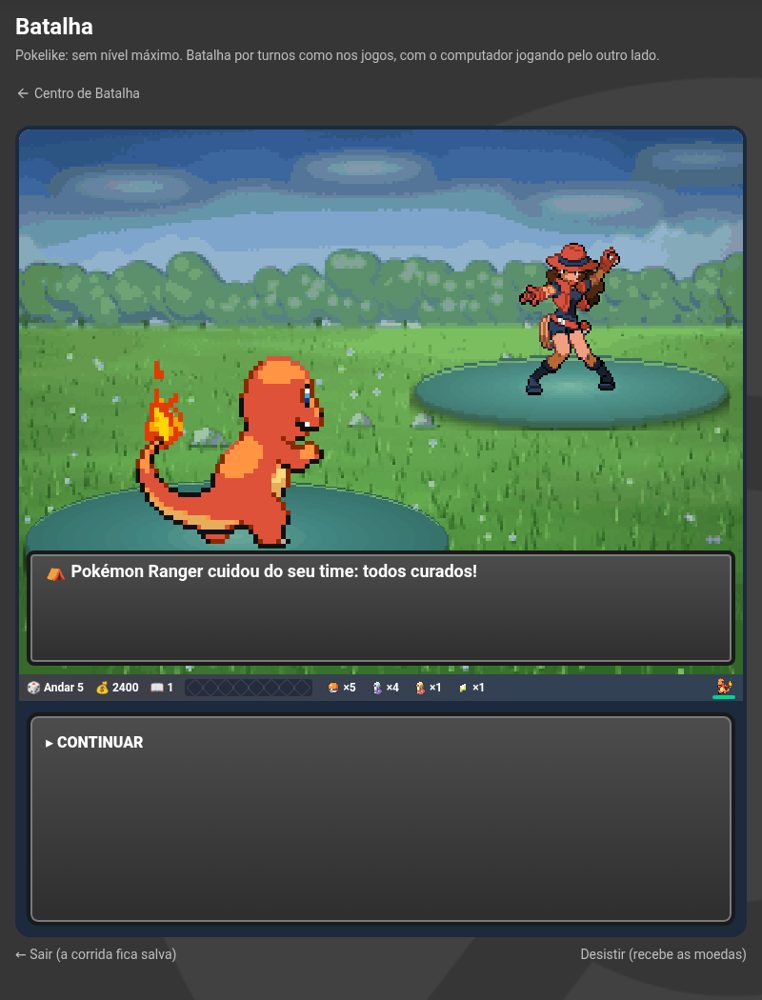</td>
  </tr>
</table>

Fora da cidade o time não é curado entre os andares. Às vezes aparece no caminho alguém que cura todo mundo, como o Pokémon Breeder ou a Enfermeira Joy.

#### Battle Factory: resultado do andar

<table>
  <tr><th>📱 App</th><th>💻 Site</th></tr>
  <tr>
    <td align="center" valign="top">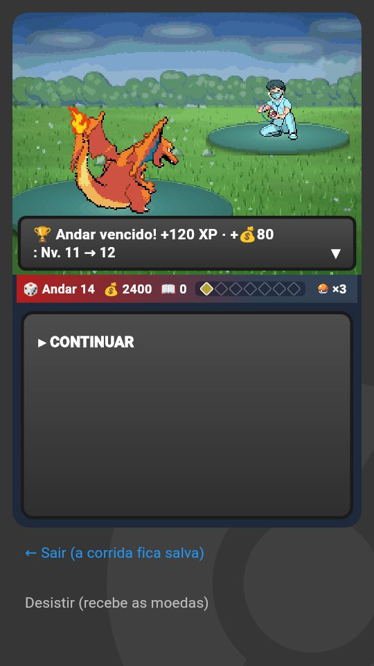</td>
    <td align="center" valign="top">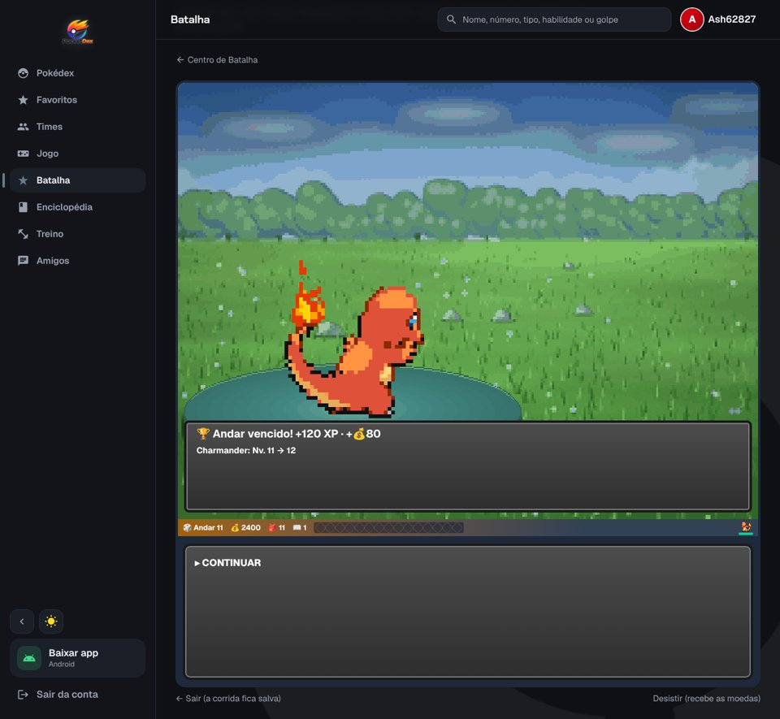</td>
  </tr>
</table>

Depois de cada vitória: o XP e o dinheiro ganhos, quem subiu de nível ou evoluiu, os itens achados e a missão da rota.

---

## 💚 Apoie o projeto

O PocketDex é gratuito e sem anúncios. Se ele te ajuda, qualquer valor por **Pix** ajuda a manter o projeto:

**Chave Pix (aleatória):** `b2f17626-44c0-421d-9a60-71a33b272741`

No app e no site, em **Configurações**, tem o QR Code e o "Pix copia e cola".

## 🛠️ Ferramentas usadas

| Parte | Ferramentas |
|---|---|
| **App (Android)** | Flutter / Dart, Provider |
| **Site** | React, Vite, Tailwind CSS, Framer Motion, React Router, Zustand |
| **Batalha** | Motor próprio sobre o simulador do Pokémon Showdown (`@pkmn/sim`), o mesmo no app (QuickJS) e no site |
| **Conta e dados online** | Firebase Authentication e Firestore |
| **Banco de dados local** | JSON e imagens em `assets/database/`, gerados com Python a partir da PokeAPI |
| **Publicação** | GitHub Actions (conferência automática, site no GitHub Pages e APK em Releases) |

## 📥 Como usar

* **Site:** https://octaviokonzen.github.io/Pocketdex/
* **App:** no site, clique em **Baixar app** (ou vá em [Releases](https://github.com/OctavioKonzen/Pocketdex/releases/latest)), instale o `PocketDex.apk` e entre com a mesma conta do site. O próprio app avisa quando sai uma versão nova.

## 🚀 Como rodar o código

```bash
git clone https://github.com/OctavioKonzen/Pocketdex.git
cd Pocketdex

# App
flutter pub get
flutter run

# Site
cd web-site
npm install
npm run data
npm run dev
```

Detalhes técnicos (Firebase, publicação de versões, banco de dados): [docs/DESENVOLVIMENTO.md](docs/DESENVOLVIMENTO.md).

## 🙏 Créditos

* Dados e sprites: [PokeAPI](https://pokeapi.co/) (repositório [PokeAPI/sprites](https://github.com/PokeAPI/sprites)). Pokémon e os nomes, imagens e sons são da Nintendo, Game Freak e The Pokémon Company.
* Sprites animados, no banco do site (o app puxa da nuvem): no estilo Black & White, os oficiais do Black & White (até o #649) e, do #650 em diante, os animados no estilo BW da pasta `gen5ani` do Pokémon Showdown; sem animação BW, a arte BW parada do [Smogon Sprite Project](https://www.smogon.com/forums/forums/smeargles-studio.258/) ([smogon/sprites](https://github.com/smogon/sprites)), também nas costas (`tool/bw_style_sprites.py`). Animações BW feitas por fãs para quem não tem a do Showdown: [Animated sprites by Ghasty001](https://github.com/Ghasty001/Animated_sprites_by_Ghasty001) e os artistas das bases (hexagonereal, Kyledove, Bloxable, KingOfThe-X-Roads, G.E.Z, Katten, aXl, Antiant e os outros listados lá) (`tool/fan_sprites.py`). A maior parte das animações (todos os Pokémon, Megas, formas regionais e formas só de aparência, como Vivillon, Unown e Alcremie) vem do [Animated Pokemon System](https://eeveeexpo.com/resources/1544/) (plugin do Pokémon Essentials por Lucidious89, baseado no Generation 8 Pack de Golisopod User e no EBDX de Luka S.J.): as animações do plugin espanhol "Sprites Animados" (Tenshi of War, DPertierra, Skyflyer, Hellfire_raptor, Antiant, Diegotoon20, KingOfThe-X-Roads e os outros listados lá) sobre os sprites dos projetos X/Y, Sun/Moon, Sword/Shield e Scarlet/Violet da Smogon (`tool/aps_sprites.py`). Mega Zygarde: animação de [RetroNC](https://www.youtube.com/@RetroNC) ([DeviantArt](https://www.deviantart.com/retronc/art/Mega-Zygarde-Gen-5-Pokemon-Sprite-1260116710)). Charizard Gigantamax: animação de [noirium](https://www.deviantart.com/noirium) ([DeviantArt](https://www.deviantart.com/noirium/art/Gigantamax-Charizard-Animated-Sprite-934376791)), usada sem fins lucrativos, com crédito ao artista. Gigantamax (frente e costas, inclusive o Charizard de costas e shiny), Eternamax e Zarude Dada: animações de [mangalos810](https://www.deviantart.com/mangalos810) (DeviantArt), usadas sem fins lucrativos, com crédito ao artista. Desenhados em escala inteira (cada pixel do mesmo tamanho, sem borrar).
* Treinadores da batalha e da foto de perfil (`tool/build_trainers.py`): os sprites animados no estilo Black & White do [Elite Battle System / EBDX](https://luka-sj.com/res/ebs4) para Pokémon Essentials (Luka S.J. e os spriters da comunidade listados lá), base © Nintendo/Game Freak; usados sem fins lucrativos, com crédito aos autores.
* Líderes, Elite Four, campeões, vilões e protagonistas animados (`tool/build_leader_trainers.py`): pacote [Animated Trainer Intros](https://eeveeexpo.com/resources/1667/) (add-on do Deluxe Battle Kit, Lucidious89, sobre o Animated Pokémon System e o EBDX de Luka S.J.), sprites das gerações 4 e 5 © Nintendo/Game Freak; usados sem fins lucrativos, com crédito aos autores.
* Desafio dos Líderes (`tool/build_gym_leaders.py`): os times originais de cada líder de ginásio, Elite Four e campeão, já evoluídos e no nível 50.
* Treinadores do [Pokémon Showdown](https://play.pokemonshowdown.com/sprites/trainers/) (`tool/build_showdown_trainers.py`): sprites 80 × 80 © Nintendo/Game Freak e dos artistas creditados em [play.pokemonshowdown.com/credits](https://pokemonshowdown.com/credits); usados sem fins lucrativos, com crédito aos autores.
* Times oficiais dos personagens (`tool/build_official_teams.py`): tirados do código dos jogos pelos projetos de desmontagem do [pret](https://github.com/pret) (pokered, pokeyellow, pokegold, pokecrystal, pokeruby, pokeemerald, pokefirered e pokeplatinum); nature, habilidade e IVs calculados como o próprio jogo faz. Black 2/White 2: a desmontagem [pokebw2](https://github.com/fuddlesworth/pokebw2), com a nature e a habilidade calculadas como o jogo (`tr_tool.c`). Scarlet/Violet (versão 1.0, sem as DLCs): a tabela de treinadores do jogo (`trdata_array`) como está no [SV-Randomizer](https://github.com/XLuma/SV-Randomizer), com a conversão das espécies do [PKHeX](https://github.com/kwsch/PKHeX). Diamond/Pearl, HeartGold/SoulSilver, Black/White, X/Y, Omega Ruby/Alpha Sapphire, Sun/Moon, Ultra Sun/Ultra Moon, Sword/Shield e Brilliant Diamond/Shining Pearl (marcados como dados da comunidade): os dados de treinadores do [Trevenant](https://github.com/zacharybussey/Trevenant) (MIT), vindos do VanillaNuzlockeCalc (Honko e colaboradores). Só os dados (níveis, golpes, itens), nenhum código dos jogos.
* Calculadora de dano ([@smogon/calc](https://github.com/smogon/damage-calc)), sets prontos e regras dos golpes do [Pokémon Showdown](https://github.com/smogon/pokemon-showdown) (licença MIT).
